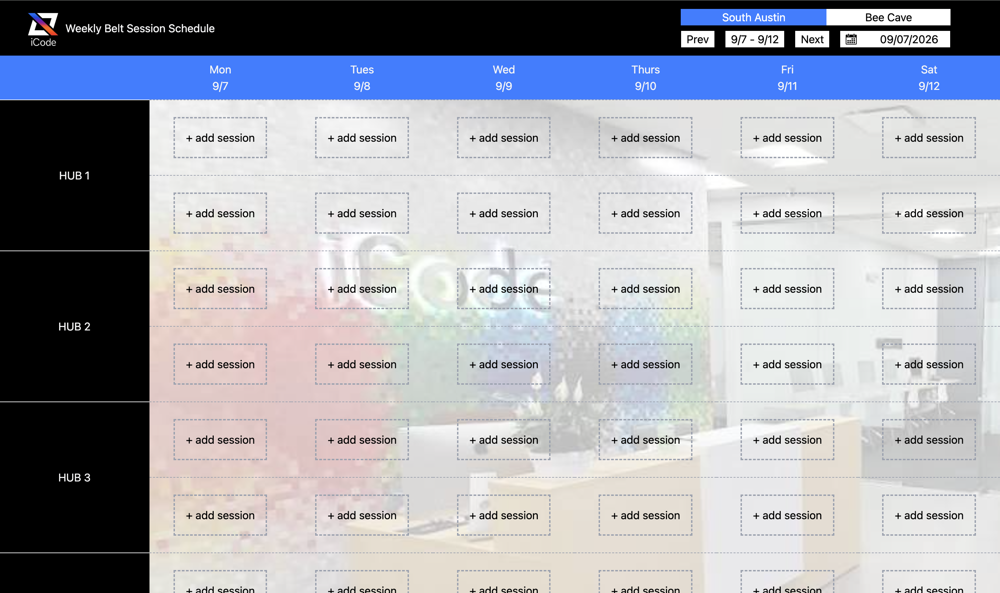
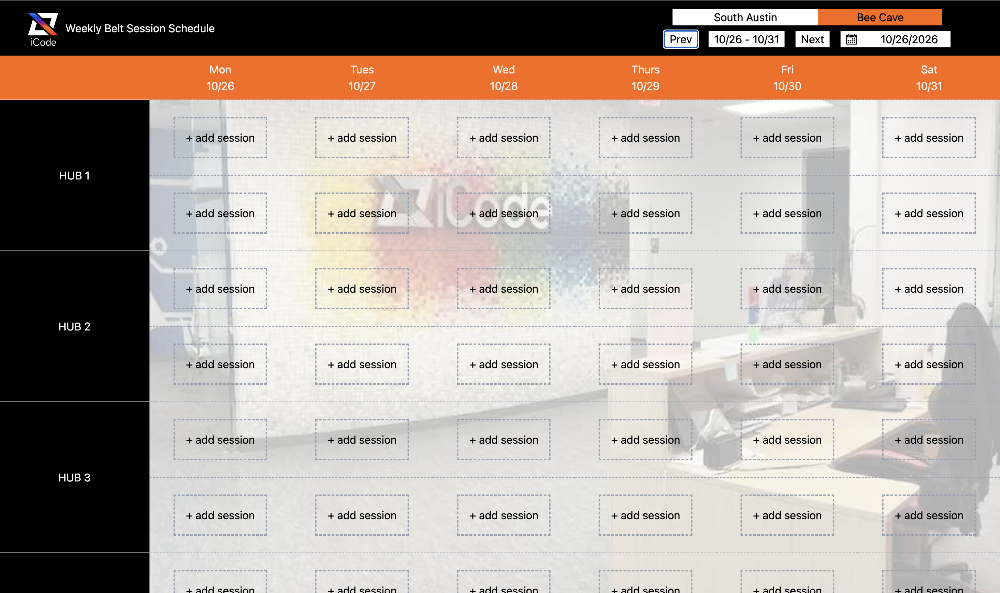

# Schedule

A React + TypeScript app for managing class/session scheduling, built with Vite.

This project is currently being used to build a session edit modal and scheduling UI for class records.

 

## Current project goal

Create a schedule management interface where users can:

- view and edit session details
- select instructors and class status
- assign hub and class type
- choose start/end times
- add notes
- delete, cancel, or save session updates

## Current app structure

The app is organized around a few reusable UI pieces and page views, including:

- `App.tsx`
- `pages/Home.tsx`
- `pages/Austin.tsx`
- `pages/BeeCave.tsx`
- `components/Modal.tsx`
- `components/Navbar.tsx`
- `components/Datebar.tsx`
- `components/Calbar.tsx`
- `components/CalPicker.tsx`
- `components/HubBar.tsx`
- `components/SessionBtn.tsx`
- `components/Togglebar.tsx`

## Current session modal fields

The modal currently includes the following form components and inputs:

- Instructor
- Sub checkbox
- Class Status
- Hub
- Belt Classes
- Camp Classes
- Start Time
- End Time
- Notes
- Delete button
- Cancel button
- Save button

## Current state being tracked

The modal is currently tracking values like:

- instructor
- isSubChecked
- status
- hub
- belt
- camp
- startTime
- endTime
- description

This is a good place to add more fields as the scheduling workflow grows.

## Tech stack

- React
- TypeScript
- Vite
- Tailwind CSS

## Notes for continued development

This README will continue to be updated as the app evolves.

Use this section to document new form fields, UI logic, or business rules as they are added.

## Update log

### Current input checklist

- [x] Instructor
- [x] Sub checkbox
- [x] Class Status
- [x] Hub
- [x] Belt Classes
- [x] Camp Classes
- [x] Start Time
- [x] End Time
- [x] Notes
- [x] Delete
- [x] Cancel
- [x] Save

### Add as the project grows

- [ ] Time conflict alert
- [ ] Delete All btn for recurring events

- [ ] Read only link for viewers
- [ ] Dropdown calendar to reflect all 12 months, previous and future selections
- [ ] Add the director on-site option

## Future improvements

- Improve loading sessions
- Style the edit icon to a white color so it contrasts well against the darker belt color sessions
